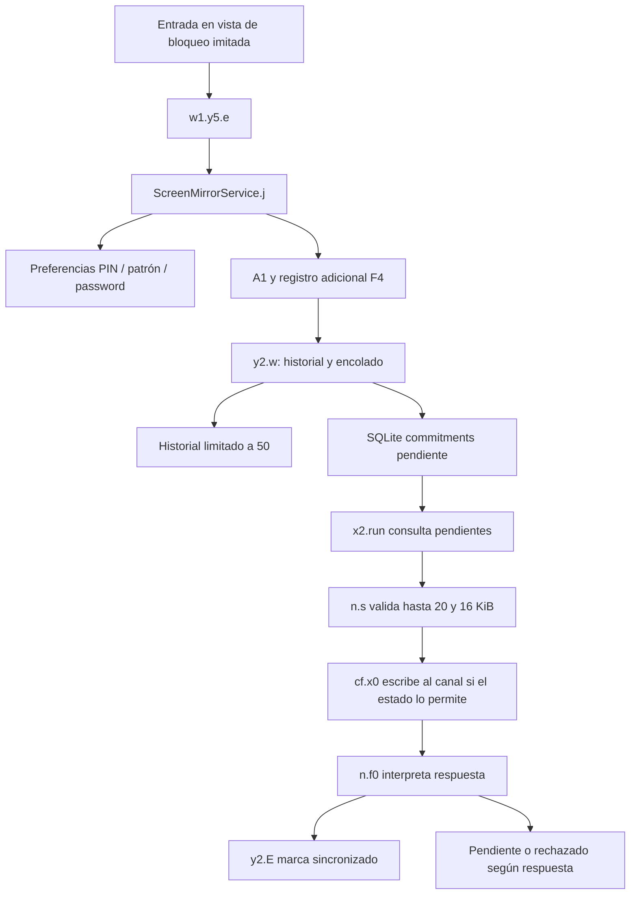

# Recorrido de datos recuperado

El diagrama une llamadas observadas e interpretación estática. No representa tráfico capturado ni ejecución observada en el celular.

## Tres estructuras distintas

1. **Valor actual:** claves de SharedPreferences para PIN/password y patrón. Es almacenamiento de valores recibidos, no un acceso universal al almacén de contraseñas de Google.
2. **Historial local:** `password_history`, reducido a 50 elementos por el `while` de `y2.w`.
3. **Cola de salida:** tabla `commitments`. La consulta de pendientes selecciona hasta 20; el serializador vuelve a imponer ese límite y un tamaño máximo de 16384 bytes.

El serializador A01 crea objetos con identificador, valor, modo, procedencia y tiempo. El procesador A02 reconoce una confirmación y sus IDs. A09 muestra la actualización de estado de sincronización; no eliminación.

## Lectura concreta

- [Guardar valores](../01_CODIGO_CLAVE/01_Guardar_PIN_patron_password.java).
- [Historial](../01_CODIGO_CLAVE/03_Historial_y_cola.java).
- [Preparar lote y recorrerlo](../01_CODIGO_CLAVE/NUEVOS/A01_historial_serializador.java).
- [Interpretar confirmación](../01_CODIGO_CLAVE/NUEVOS/A02_confirmacion_lotes.java).
- [Actualizar estado](../01_CODIGO_CLAVE/NUEVOS/A09_marcar_sincronizados.java).

La captura real depende de interacción, permisos, ventanas accesibles y estado. Los archivos no permiten afirmar qué valores se capturaron del usuario ni que salieran del dispositivo.
