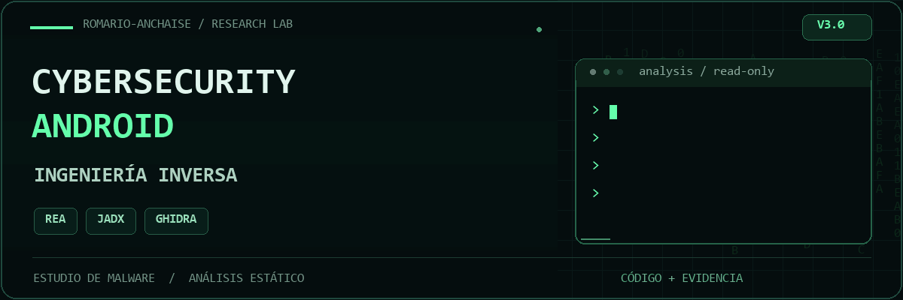

<p align="center">
  
</p>

<p align="center">
  <a href="Laboratorio_CosaRara_REA_V3/00_EMPIEZA_AQUI.md"><strong>EXPLORAR EL LABORATORIO</strong></a>
  &nbsp; · &nbsp;
  <a href="Laboratorio_CosaRara_REA_V3.zip"><strong>DESCARGAR V3</strong></a>
  &nbsp; · &nbsp;
  <a href="assets/cyber-lab-banner-static.png">Ver portada sin animación</a>
</p>

# Laboratorio de análisis de CosaRara — V3

Material de estudio de ingeniería inversa de los APK CosaRara y CosaRara Player, analizados estáticamente con REA, JADX y Ghidra.

## Empezar

- **[Guía principal](Laboratorio_CosaRara_REA_V3/00_EMPIEZA_AQUI.md)**: recorrido por el código y las evidencias.
- **[Descargar el laboratorio V3 en ZIP](Laboratorio_CosaRara_REA_V3.zip)**.
- Para VS Code, abre `Laboratorio_CosaRara_REA_V3/Abrir_Laboratorio.code-workspace`.

## Contenido

| Carpeta | Contenido |
|---|---|
| [01_CODIGO_CLAVE](Laboratorio_CosaRara_REA_V3/01_CODIGO_CLAVE) | Métodos seleccionados y nuevas consultas de REA. |
| [02_CODIGO_COMPLETO](Laboratorio_CosaRara_REA_V3/02_CODIGO_COMPLETO) | Clases recuperadas en Java. |
| [03_NATIVO_ARM64_Y_OTRAS_ABI](Laboratorio_CosaRara_REA_V3/03_NATIVO_ARM64_Y_OTRAS_ABI) | Pseudocódigo de ARM64, ARM de 32 bits y x86-64. |
| [04_EVIDENCIAS_REA](Laboratorio_CosaRara_REA_V3/04_EVIDENCIAS_REA) | Registros de evidencia y sus limitaciones. |
| [05_GUIAS](Laboratorio_CosaRara_REA_V3/05_GUIAS) | Automatizaciones, recorrido de datos, conexiones y calidad de recuperación. |
| [06_MANIFIESTOS_RECURSOS](Laboratorio_CosaRara_REA_V3/06_MANIFIESTOS_RECURSOS) | Manifiestos, componentes, permisos e inventarios. |
| [07_CONFIGURACION_DESCIFRADA](Laboratorio_CosaRara_REA_V3/07_CONFIGURACION_DESCIFRADA) | Inventario analítico de 126 perfiles recuperados. |
| [08_AUDITORIA](Laboratorio_CosaRara_REA_V3/08_AUDITORIA) | Cobertura, índices y avisos del descompilador. |

La V3 incorpora 16 consultas nuevas de REA, además de evidencia anterior. Contiene 3.006 archivos Java, incluidos fragmentos seleccionados, y pseudocódigo nativo de tres arquitecturas. Los recuentos exactos están en [COBERTURA.json](Laboratorio_CosaRara_REA_V3/08_AUDITORIA/COBERTURA.json).

## Alcance

El contenido es una reconstrucción para lectura y estudio defensivo. Conserva ofuscación y errores de descompilación; no es el código fuente original ni un proyecto listo para compilar. No incluye APK, DEX ni bibliotecas nativas ejecutables.

No se ejecutaron las muestras ni se contactaron sus servidores durante este análisis. Las capacidades encontradas no prueban que se ejecutaran en un teléfono concreto ni identifican a sus responsables.

## Integridad

El ZIP y la carpeta V3 se publican con sus bytes preservados. `.gitattributes` evita convertir finales de línea. La huella del ZIP es:

```text
cd1cb70673e480957644e80b98103220c81066f7a52b006f7bf70e47bd112ea4
```
